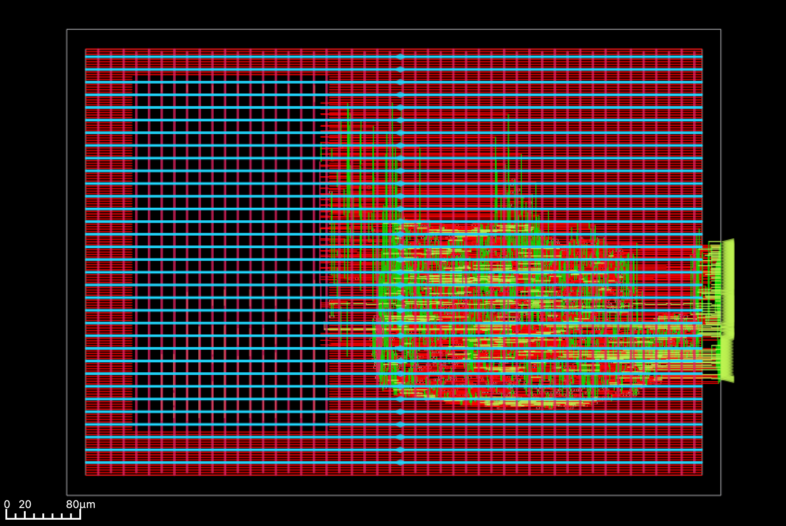
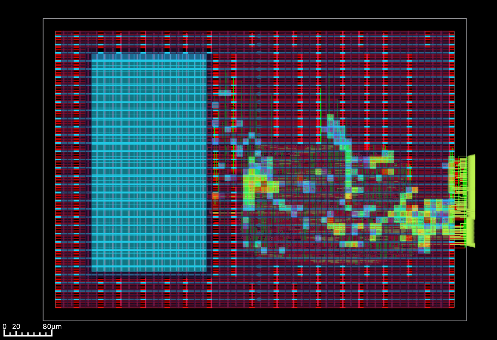
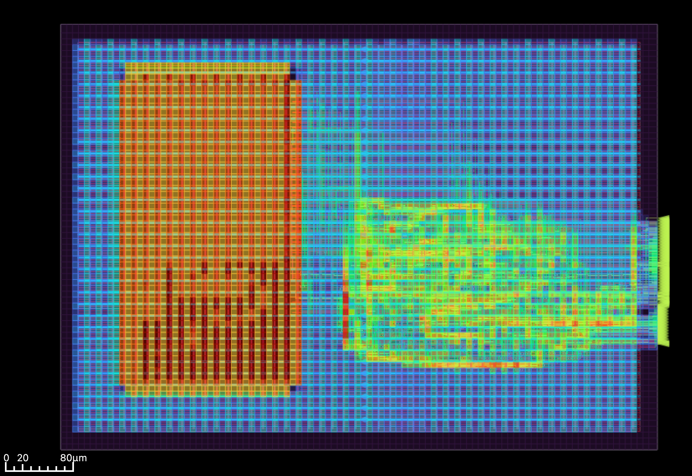

# Lab 5 — Dot-Product Accelerator ASIC Implementation

Implemented and evaluated a dot-product accelerator with an integration of a SRAM using an open-source ASIC flow

## Design and implementation

- **RTL verification:** Simulation with SystemVerilog and Verilator.
- **Synthesis:** Yosys, with the SRAM macro kept as a hard-macro black box.
- **Physical design:** OpenROAD floorplanning, placement, power distribution (PDN), clock-tree synthesis (CTS), and global/detailed routing.
- **Timing analysis:** Post-route RC extraction and static timing analysis (STA), and a post-CTS optimization.

## Post-route timing results

| Metric | Baseline | Post-CTS optimized |
|---|---:|---:|
| Worst setup slack | +8.902 ns | +8.412 ns |
| Worst hold slack | +0.160 ns | +0.269 ns |
| Setup total negative slack | 0 ns | 0 ns |

## Layout







## Repository guide

- `src/` — Dot-product RTL and testbenches.
- `local_openroad/scripts/` — Synthesis and physical-design scripts.
- `local_openroad/reports/` — Timing reports and setup-slack histogram.

## Running the OpenROAD ASIC Flow

The dot-product accelerator is implemented using Yosys, OpenROAD, Sky130 HD standard cells, and an SRAM22 macro.

**Prereq:** OpenROAD, Sky130 HD libraries, sram22_64x32m4w8 (Provided by UCB EECS), and the synthesized netlist. 

### Complete ASIC Flow

```bash
cd ~/Documents/eecs151-asic-lab-sp26/lab5

OPENROAD="$HOME/Documents/eda-tools/install/OpenROAD-GUI/bin/openroad"

# Stop on errors
set -e

mkdir -p local_openroad/{logs,results}
mkdir -p local_openroad_q4/{logs,results,reports}

# 1. RTL Synthesis
echo "===== 1. Synthesis ====="
bash local_openroad/scripts/syn_dot_product.sh

# 2. Floorplanning and SRAM Placement
echo "===== 2. Floorplanning ====="
"$OPENROAD" -exit \
  -log local_openroad_q4/logs/floorplan_dot_product.log \
  local_openroad_q4/scripts/floorplan_dot_product.tcl

# 3. Standard Cell Placement
echo "===== 3. Placement ====="
"$OPENROAD" -exit \
  -log local_openroad_q4/logs/placement_dot_product.log \
  local_openroad_q4/scripts/placement_dot_product.tcl

# 4. Power Distribution Network (PDN)
echo "===== 4. PDN ====="
"$OPENROAD" -exit \
  -log local_openroad_q4/logs/pdn_dot_product.log \
  local_openroad_q4/scripts/pdn_and_place_dot_product.tcl

# 5. Clock Tree Synthesis
echo "===== 5. CTS ====="
"$OPENROAD" -exit \
  -log local_openroad_q4/logs/cts_dot_product.log \
  local_openroad_q4/scripts/cts_dot_product.tcl

# 6. Post-CTS Optimization
echo "===== 6. Post-CTS Optimization ====="
"$OPENROAD" -exit \
  -log local_openroad_q4/logs/post_cts_opt_dot.log \
  local_openroad_q4/scripts/post_cts_opt_dot.tcl

# 7. Global and Detailed Routing
echo "===== 7. Routing ====="
"$OPENROAD" -exit \
  -log local_openroad_q4/logs/route_opt_dot.log \
  local_openroad_q4/scripts/route_opt_dot.tcl

# 8. Post-Route STA
echo "===== 8. STA ====="
"$OPENROAD" -exit \
  -log local_openroad_q4/logs/post_route_sta_opt_dot.log \
  local_openroad_q4/scripts/post_route_sta_opt_dot.tcl

# 9. Open Final Layout in GUI
echo "===== 9. OpenROAD GUI ====="
"$OPENROAD" -gui \
  local_openroad_q4/scripts/view_q4_layout.tcl
```
