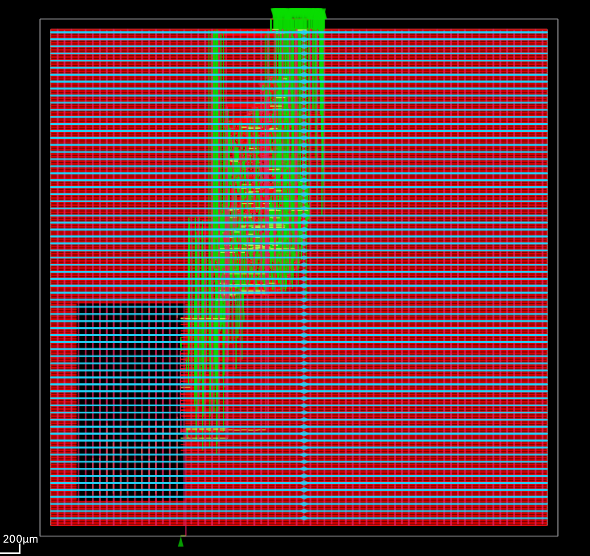
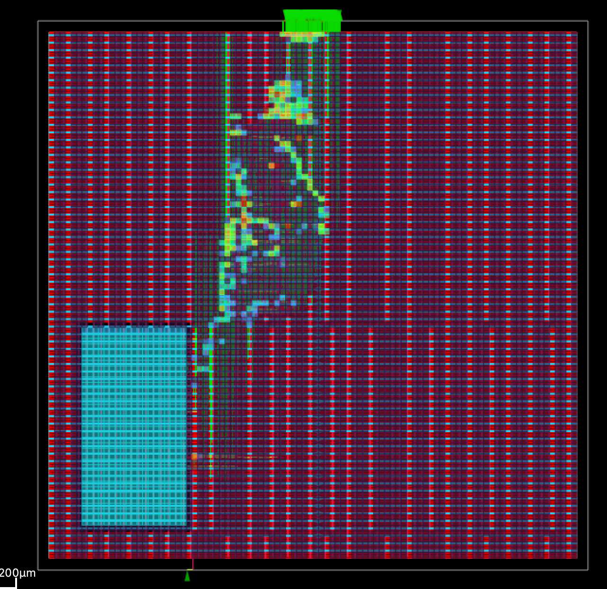

# Lab 5 — Dot-Product Accelerator ASIC Implementation

Implemented and evaluated a dot-product accelerator with an integration of a SRAM using an open-source ASIC flow

## Design and implementation

- **RTL verification:** Simulation with SystemVerilog and Verilator.
- **Synthesis:** Yosys, with the SRAM macro kept as a hard-macro black box.
- **Physical design:** OpenROAD floorplanning, placement, power distribution (PDN), clock-tree synthesis (CTS), and global/detailed routing.
- **Timing analysis:** Post-route RC extraction and static timing analysis (STA), and a post-CTS optimization.

## Post-route timing results

| Metric | Baseline | Post-CTS optimized |
|---|---:|---:|
| Worst setup slack | +8.902 ns | +8.412 ns |
| Worst hold slack | +0.160 ns | +0.269 ns |
| Setup total negative slack | 0 ns | 0 ns |

## Layout

## Repository guide

- `src/` — Dot-product RTL and testbenches.
- `local_openroad/scripts/` — Synthesis and physical-design scripts.
- `local_openroad/reports/` — Timing reports and setup-slack histogram.
